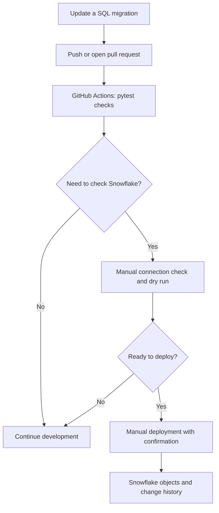

# Snowflake DataOps

I built this project to practise a common data engineering task: changing a Snowflake database without relying on someone to run SQL by hand every time.

The idea is simple. SQL changes live in versioned migration files, GitHub Actions checks those files, and a separate workflow lets me preview or apply the migrations to my Snowflake demo environment. I used **schemachange** to manage the migrations.

## How it works

A change starts in GitHub. The validation workflow runs the migration-file tests on pushes and pull requests. When I need to check Snowflake connectivity or preview a deployment, I can run the migration-check workflow manually. Applying migrations is a separate manual step and requires a confirmation phrase.



The validation and connection-check workflows do not apply migrations. The deployment workflow does execute SQL against the configured Snowflake account, so it should only be run after checking the target environment and permissions.

## What I implemented

- Versioned SQL migrations for the demo schema, tables, view, and an additive customer column.
- GitHub Actions tests for migration file naming, version ordering, duplicate versions, expected objects, empty files, and common hard-coded secret patterns.
- A manual Snowflake connection check with a dry-run preview.
- A manual deployment workflow with an explicit confirmation input and concurrency control to prevent overlapping runs.
- A dedicated `DATAOPS_DEPLOY_ROLE` for the Snowflake check and deployment workflows.

## Migration history

| Version | Change |
| --- | --- |
| `1.0.0` | Create the `DATAOPS_DEMO` schema if it does not exist |
| `1.1.0` | Create the `CUSTOMERS` and `ORDERS` tables |
| `1.2.0` | Create or replace the `ORDER_SUMMARY` view |
| `1.3.0` | Add a nullable `CUSTOMER_SEGMENT` column to `CUSTOMERS` |

I deployed these migrations to a Snowflake demo environment. The migration history recorded versions `1.0.0`, `1.1.0`, and `1.2.0` as successful on the initial deployment. I later deployed `1.3.0` and checked that the new column existed. I also queried `ORDER_SUMMARY` to check the customer-level order totals.

Migration files use this naming pattern:

```text
V<major>.<minor>.<patch>__<description>.sql
```

Once a migration has been applied to a shared environment, I leave that file unchanged and create a new version for the next database change.

## Repository structure

```text
.github/workflows/
  validate.yml
  snowflake-check.yml
  snowflake-deploy.yml
docs/
  least-privilege-setup.sql
migrations/
  V1.0.0__create_schema.sql
  V1.1.0__create_tables.sql
  V1.2.0__create_views.sql
  V1.3.0__add_customer_segment.sql
tests/
  test_migration_files.py
requirements.txt
schemachange-config.yml
```

## Running the checks locally

The CI workflow uses Python 3.12. Python 3.10 or newer is needed to run the project locally.

```bash
python -m pip install -r requirements.txt
python -m pytest -v
```

## Connecting GitHub Actions to Snowflake

Add the following repository secrets in GitHub Settings. Do not put credentials in the repository.

- `SNOWFLAKE_ACCOUNT`
- `SNOWFLAKE_USER`
- `SNOWFLAKE_PASSWORD`

The workflows are configured for warehouse `DATAOPS_WH`, database `DATAOPS_DB`, and schema `DATAOPS_DEMO`. Update the workflow files and `schemachange-config.yml` if you use different names.

For the deployment workflow, configure a GitHub Actions environment named `snowflake-demo`. The workflow expects the confirmation value `DEPLOY_TO_DATAOPS_DEMO`. Check the account, role, warehouse, database, schema, and credentials before running it. Environment protection rules or required reviewers can add another layer of control where available.

The connection-check workflow verifies access and previews the migrations; it does not apply them. The deployment workflow does apply SQL, so don't point it at a shared or production environment without the right approval.

## Checking the result in Snowflake

After deployment, I used these queries to inspect migration history and confirm the objects were available:

```sql
SELECT *
FROM DATAOPS_DB.DATAOPS_DEMO.CHANGE_HISTORY
ORDER BY INSTALLED_ON;

SHOW TABLES IN SCHEMA DATAOPS_DB.DATAOPS_DEMO;
SHOW VIEWS IN SCHEMA DATAOPS_DB.DATAOPS_DEMO;

SELECT *
FROM DATAOPS_DB.DATAOPS_DEMO.ORDER_SUMMARY;
```

The `1.3.0` change can also be checked with:

```sql
DESC TABLE DATAOPS_DB.DATAOPS_DEMO.CUSTOMERS;
```

## Permissions and security notes

The role setup is documented in [`docs/least-privilege-setup.sql`](docs/least-privilege-setup.sql). I created and reviewed the grants for `DATAOPS_DEPLOY_ROLE`, including access to the migration history and the `ORDERS` table. Both the connection-check and deployment workflows have run using this role in the demo environment.

The migration tests are basic static checks. They are useful guardrails, but they are not a SQL parser or a complete secret scanner. For a production setup, I'd use a dedicated service user, review the exact required grants, and protect deployments with the team's approval process.

